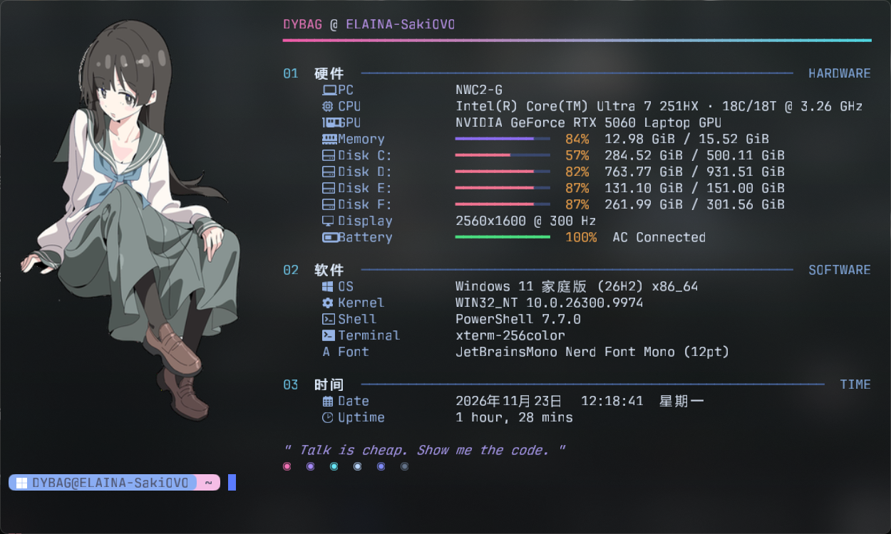

  

<h1 align="center">VectorTerm v1.0.0</h1>

<b>首个大版本 · 渲染层真毛玻璃 · 失焦不掉 · 只剩终端的极简主题</b>

这是 VectorTerm 的第一个大版本。终端核心继续复用 wezterm 的 `wezterm-term` 状态机，
这一版把重心放在**渲染层**和**交互手感**：把"毛玻璃"从一层假装磨砂的贴图做成了真正的
系统磨砂，并且修掉了 wezterm 上「窗口一失焦毛玻璃就失效」的老毛病；同时新增了一套
完全没有标签栏、按钮和标题栏的极简主题 —— 上面这张就是它的真实窗口帧，不是效果图。

---

## ✨ 这一版有什么

### 1. 渲染层真毛玻璃，而且失焦不掉

- `win32_system_backdrop = "Acrylic"` 走 Windows 系统背板（accent blur），**窗口失焦后依然保留磨砂**
  —— wezterm 的已知问题在这里修掉了。
- 逐像素 alpha 通过 DirectComposition 合成交换链实现，只有背景层半透明，**文字保持实心**；
  CPU 后端拿不到逐像素 alpha 时窗口保持不透明，绝不会把文字一起压淡。
- `window_background_opacity` 叠几层也**只乘一次**，消掉了标签栏下方那条"半截毛玻璃"的横带。
- 新增 `text_background_opacity`：单元格自设底色独立于窗口透明度。oh-my-posh 的
  ` DYBAG@ELAINA-SakiOVO` 提示符色块在玻璃上仍是原色，不再"两头亮中间灰"。
- 玻璃窗口等 GPU 后端就绪才显示，不会先闪一帧半透明文字。

### 2. 两套玻璃配方，其中一套「只剩终端」

- **`deepseek-glass.lua`** —— 中性石墨灰 `#15181D` 底 + 55% 背景透明 + 完整标签栏 / 状态栏。
  底色刻意选了中性灰而不是夜空蓝：蓝底叠上桌面会整窗发蓝，灰底才让品牌蓝只留在光标、
  选区、活动标签这些点缀上。
- **`deepseek-glass-minimal.lua`** —— 同一套玻璃，**没有标签栏、没有按钮、没有标题栏**，窗口里只剩终端：
  - 顶部一条与标签栏等高的区域是**隐形拖动带**，鼠标移上去变成抓手，直接拖即可；
  - 失去焦点时四周淡入一圈 **1px 白边**（220ms 缓入，140ms 收回），用来分辨焦点归属；
  - 也可以在任意位置按住 `Super + 左键` 拖动窗口。

### 3. 渲染细节逐格对齐 wezterm

- **Powerline 分隔符**（`U+E0B0`–`U+E0BF`）不再取字体字形，直接按格子几何绘制：段与段之间不会再漏出
  一条背景色的缝，圆头不会被拉成椭圆，换字体也不变形。
- Nerd Font / PUA 图标按**字体原尺寸**绘制，墨迹中线对齐旁边的文字，不再又小又歪。
- 半块与象限块（`▄▀█▌▐`）按格子填矩形，上下行之间没有横缝。
- 底边留白固定。

### 4. 配套工具与工程质量

- 配置管理器补齐全部玻璃相关配置项（`focus_border.*`、`text_background_opacity`、
  `tab_bar.keep_as_title_bar` 等），拖滑杆即可调。
- 新增 CI：push / PR 自动跑文档审计 + 测试，发版前也审计一遍，断链与表格错列不再是"发完才发现"。
- 文档全面刷新：头图与主题配图换成**真实窗口帧**，补全配置手册 §19 模板，主题数量、脚本数量等
  过时说法对齐现状。
- 内置主题增至 **6 份**，诊断脚本 **44 个**；全部 **347 项测试通过**。

---

## 📦 安装与升级

下载下方资产里的 **`VectorTerm-1.0.0-setup.exe`**，中文安装向导，默认安装到当前用户，
不需要管理员权限。`SHA256SUMS.txt` 可用于校验安装包。

- **环境要求**：Windows 10 1809+（ConPTY）。
- **玻璃效果**：需要 GPU 后端（`render = "auto"` 或 `"gpu"`，默认即 auto）。
- **从 0.1.x 升级**：直接运行安装包覆盖即可；配置文件在 `%USERPROFILE%\.config\VectorTerm\current\`，
  不会被安装过程覆盖。

---

## ⚠️ 已知限制

- 毛玻璃依赖 GPU / DirectComposition。CPU 后端下窗口保持不透明是**有意设计**，避免文字被压淡，
  详见 [已知限制](https://github.com/yunshangnanchen/VectorTerm/blob/main/docs/limitations.md)。
- 仅支持 Windows，不跨平台。
- 首次打开玻璃窗口需要等 GPU 后端初始化，实测数据见
  [毛玻璃启动与运行时性能评估](https://github.com/yunshangnanchen/VectorTerm/blob/main/docs/benchmark/glass-startup-performance.md)。

## 🔗 链接

- [README](https://github.com/yunshangnanchen/VectorTerm/blob/main/README.md) ·
  [配置手册](https://github.com/yunshangnanchen/VectorTerm/blob/main/docs/config-manual.md) ·
  [自定义背景（毛玻璃原理）](https://github.com/yunshangnanchen/VectorTerm/blob/main/docs/custom-background.md) ·
  [构建指南](https://github.com/yunshangnanchen/VectorTerm/blob/main/docs/build.md)

---

**完整变更**：`git log v0.1.1..v1.0.0`
