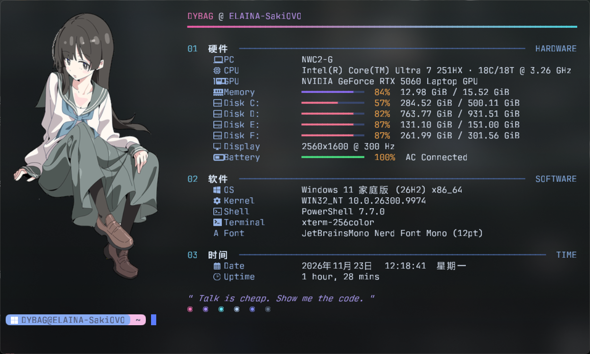

  

<h1 align="center">VectorTerm v1.2.0</h1>

<b>渲染质量专项 · 字不再糊、不再被削边、图标统一到一个尺寸、整行分隔线连贯</b>

这一版没有新功能，全部工作都在像素上：把上一版"能看"的文字渲染推到"耐看"。
四个问题根因各不相同 —— GPU 字形图集的采样模式、半像素落位、图标的两套互相打架的
缩放规则、制表符字形在非整数缩放下被摊成半透明 —— 下面每条都带实测数字。

---

## ✨ 这一版修了什么

### 1. GPU 后端文字发糊 —— 根因是字形图集用了双线性采样

字形位图是**按 1:1 屏幕像素栅格化**的，一个位图像素本来就该对应一个屏幕像素。
图集却和图片共用了一个 Linear 采样器，等于每次上屏都给字做了一次低通模糊。

- 字形图集改走 **Nearest**，图片仍然是 Linear（缩放图片需要平滑，两者不该共用一个采样器）。
- UV 从"半个纹素内缩"改成**完整纹素范围** —— 内缩的那半像素在 Nearest 下会丢边、在 Linear 下会糊，
  两种模式都不对。

离屏渲染同一帧、同一份图集，取文字区边缘梯度做锐度：**GPU 62 → 82，CPU 84**。
剩下的 2 点是 ab_glyph 没有 hinting 的字体引擎差异，不是后端问题。

### 2. 文字底部和右侧像被削掉一条

基线 `ascent`、顶留白 `pad_y`、格子原点都存在 14.5px 这类半像素值，字形矩形落在半像素上之后，
最近邻采样会把首尾一行 / 一列采到隔壁纹素 —— 看上去就是笔画"少了一条"。

- 基线、格子原点、每个字形的目标矩形**一律对齐整像素**。
- 留白本身仍然可以是半像素（多个预设要对齐底边，这个约定保留），对齐只发生在绘制那一刻，
  统一收敛到 `cell_rect` 这一个入口。
- 顺带修掉一个真 bug：**缺字形（比如空格）的字符不推进笔位**，后续字符会叠在一起。

### 3. Nerd Font 图标大小不统一

系统里装的多是 Nerd Font v2，缺 v3 的码点，于是同一行图标一半来自系统字体、一半来自内置兜底字体，
两者原生尺寸差 2.6 倍；再加上旧代码对宽图标和方图标用了两套缩放规则，结果就是截图里那种大小乱跳。

- 所有 PUA 图标统一缩进「**一格半宽 × 1.10 倍文字墨迹高**」的内接框，等比缩放后在格内居中，
  墨迹中线对齐旁边文字的中线。
- **不拉伸**：显卡、内存条这类横条图标保持原比例。
- 宽度上限 1.5 格是因为图标后面固定跟一个空格；只给一格的话，方形图标最大只有一格见方，
  会比文字小一圈。现在整列图标宽度一致。

### 4. fastfetch 的横线（分隔线）发虚、断断续续

`─` 这类制表符走的是字形路径，而字体的墨迹尺寸和格子对不上：14px 字号下 `│` 墨迹高 22px 而格子只有 18px，
必须缩 1.125 倍；横向 `cell_span / advance = 8 / 8.4` 同样带小数。一条 2px 的线被摊到 3 行半透明像素
（实测 alpha 181 / 146 / 112），一整行分隔线就成了带周期性暗纹的虚线，`║` 的两条竖线还会糊成一片。

- **33 个制表符**（细线 / 粗线 / 双线各 11 个：横竖线、四个角、四个丁字、十字）改为**按格子几何直接画矩形**：
  细线 `round(cell_h / 9)`、粗线 1.5 倍、双线双轨夹一道空隙；四边各自取整后相减，相邻格天然无缝。
- 实测一整行分隔线 **alpha 98 / 98 / 98**，CPU 与 GPU 输出**逐像素一致**。

---

## 📦 安装与升级

下载下方资产里的 **`VectorTerm-1.2.0-setup.exe`**，中文安装向导，默认安装到当前用户，
不需要管理员权限。`SHA256SUMS.txt` 可用于校验安装包。

- **环境要求**：Windows 10 1809+（ConPTY）。
- **从 1.0.0 升级**：直接运行安装包覆盖即可；配置在 `%USERPROFILE%\.config\VectorTerm\current\`，
  不会被安装过程覆盖。这一版**没有改配置 schema**，旧配置照常生效。
- **看效果**：GPU 与 CPU 后端的文字现在应该看不出差别了，可以 `render = "cpu"` / `"gpu"` 来回切着对比。

---

## ⚠️ 已知限制

- 字形用 ab_glyph 栅格化，没有 FreeType 的 hinting / LCD 子像素，笔画比 wezterm 略细、边缘略软。
  这是字体引擎能力差异，不是后端 bug。
- **混合粗细**（`╭╮╯╰` 圆角、U+250D..250E、U+2511..2512）和**虚线**（U+2504..250B）制表符仍走字形路径，
  在非整数缩放下仍可能偏软。
- 毛玻璃依赖 GPU / DirectComposition，CPU 后端下窗口保持不透明是**有意设计**（避免文字被压淡）。

细节见 [已知限制](https://github.com/yunshangnanchen/VectorTerm/blob/main/docs/limitations.md)。

## 🔗 链接

- [README](https://github.com/yunshangnanchen/VectorTerm/blob/main/README.md) ·
  [配置手册](https://github.com/yunshangnanchen/VectorTerm/blob/main/docs/config-manual.md) ·
  [渲染后端对比](https://github.com/yunshangnanchen/VectorTerm/blob/main/docs/rendering-backends.md) ·
  [已知限制](https://github.com/yunshangnanchen/VectorTerm/blob/main/docs/limitations.md)

---

**完整变更**：`git log v1.0.0..v1.2.0`
