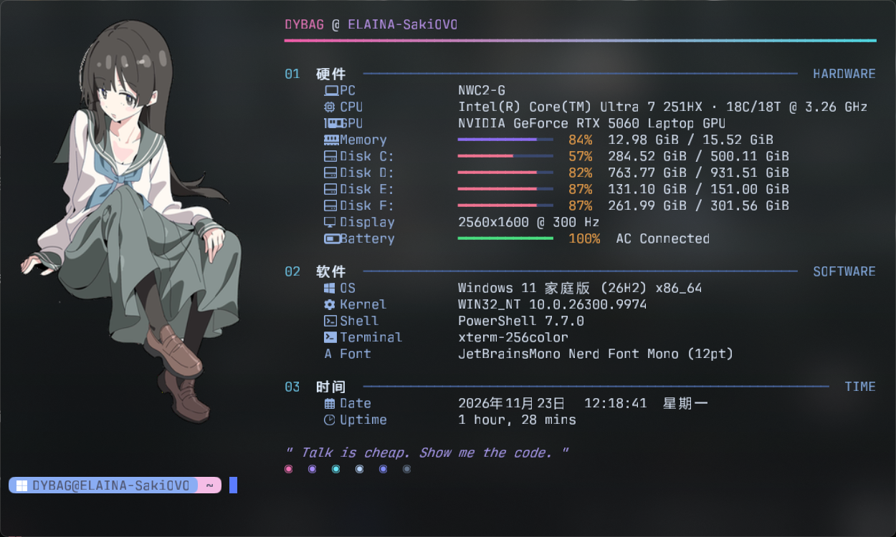

  

<h1 align="center">VectorTerm v1.2.1</h1>

<b>留白修正 · 顶部不再多出一截、上下永远等距、图标不再压字</b>

这一版没有新功能，只修 1.2.0 之后暴露出来的几处问题。除了一处安装路径的坑，其余都在"每天都要看一眼"的
层面：顶部留白比配置值大、得拖一下边框才正常；上下留白不相等；个别图标右缘压到后面的文字。

---

## ✨ 这一版修了什么

### 1. 顶部留白偏大，拖一下边框才"正常"

125% DPI、`padding = 10`（物理 12.5px）、`window_height = 750` 的配置下实测：

| 客户区高度 | 行数 | 顶部留白 |
|---|---|---|
| **750**（配置值） | 31 | **18.5px** |
| 736 / 759（拖一下之后） | 31 / 32 | 11.5px |
| **761** = 32 × 23 + 2 × 12.5 | 32 | **12.5px**（正好等于 `padding`） |

原因是**窗口高度从来不等于「整数行 + 上下留白」**：Windows 的整格缩放只把客户区对齐到
`cell_h` 的倍数、基准是 0，不带 `2 × padding`。差的 `2 × padding % cell_h`（这里是 2px）
永远凑不满一行，只能全部摊进上下留白 —— 所以内容一满屏，第一行就离上边框比配置值远 6px；
拖一下边框把高度换成某个 23 的倍数，余量变小，看上去就"正常"了。

- 客户区尺寸现在会**吸附到「整数行列 + 四周留白」**：启动时一次，拖动缩放松手时一次。
  实测上面那套配置下窗口从 `1250 × 750` 调到 `1246 × 761`，顶部 / 底部各 12.5px。
- 只在松手的边沿吸附一次，不在每轮空闲唤醒时反复请求，避免和 Aero Snap 这类系统尺寸打架。
- 窗口最大化 / 全屏时改不了尺寸，这种情况下留白仍按余量浮动 —— 这是平台限制。

### 2. 上下留白不相等：顶部忽大忽小，输入行离底忽远忽近

上一版的分配策略是"底边定值、余下的全给顶部"：底边稳了，顶部却随窗口高度在 6~22px 之间跳，
反过来又成了"顶部留白不对"。现在改成：

- **两侧同高**：先各拿 `padding + 2px` 视觉余量，剩下的余量对半分，上下差永远 < 0.5px；
  空间紧张（补贴过一行）时整体对半分。
- 同时修掉一处**启动与运行时判据不一致**：启动用 `csd() || (enabled && !hide_if_one)` 判断标签栏
  是否占高，运行时却先看 `csd` / `keep_as_title_bar`。极简玻璃配置（`enable = false`、
  `keep_as_title_bar = false`）启动时被算成"要显示标签栏"，首帧顶部凭空多出一条栏高，
  要等第一次 resize 才归零 —— 这也是"只能拖一下上边框才更新"的来源之一。现在两边共用同一个
  `tab_bar_shown()`。

### 3. Nerd Font 图标右缘压到后面的文字

图标宽度上限是按"一格半宽 ÷ 墨迹宽"算出来的，但位图宽度是 `px_bounds()` **向上取整**的：
理论 12px 可能变成 13px，刚好顶穿一格半的上限，`󰾲 GPU` 这类图标右缘会压到后面的字母。

- 改成**按栅格化后的真实位图宽度**判定，超了按比例回缩重画（最多两轮）。
- 这个只在**没装系统 Nerd Font**、图标全部落到内置 `Symbols Nerd Font Mono` 时才复现
  （CI 上就是这样），本地装了 Nerd Font 走另一条路径看不到。已补一条 `NerdFontMode::Off`
  的回归用例，本地也能复现 CI 那条路径。

### 4. 勾了"右键菜单"，打开的却是旧目录里的 exe

装了新版、右键点开，跑起来的却是以前某个目录里的 `VectorTerm.exe`（比如开发用的
`...\target\release\`）。不是安装程序没写注册表，而是**写的那一份被另一份遮住了**：

- Windows 把 `HKCU\Software\Classes` 和 `HKLM\SOFTWARE\Classes` 合成一棵树，
  同一个 verb 名（这里是 `VectorTerm`）两处都有时，**以 HKCU 为准**，HKLM 那份直接看不见。
- 安装包默认 `PrivilegesRequired=lowest`，"仅当前用户"装 → 写 HKCU；"所有用户"装 → 写 HKLM。
  于是先按当前用户装过一次、后来按所有用户装到别处，就必然踩这个坑。

现在右键菜单（以及 `Win+R` 用的 `App Paths`）**两处都写**：HKA 写安装模式对应的根，
再镜像一份到 HKCU，就地覆盖旧值，卸载时两处一起删。以后无论先装哪种、后装哪种，
右键菜单指向的都是最后安装的那一份。

> 已经装过 1.2.1 之前的版本、又被这个问题缠住的：装一次 1.2.1（勾上右键菜单）即可自动纠正；
> 不想重装也可以手动删掉 `HKCU\Software\Classes\{Directory,Directory\Background,Drive}\shell\VectorTerm`
> 这三个键，回落到 HKLM 里那份正确路径。

---

## 📦 安装与升级

下载下方资产里的 **`VectorTerm-1.2.1-setup.exe`**，中文安装向导，默认安装到当前用户，
不需要管理员权限。`SHA256SUMS.txt` 可用于校验安装包。

- **环境要求**：Windows 10 1809+（ConPTY）。
- **从 1.2.0 / 1.0.0 升级**：直接运行安装包覆盖即可；配置在
  `%USERPROFILE%\.config\VectorTerm\current\`，不会被安装过程覆盖。
  这一版**没有改配置 schema**，旧配置照常生效。
- **窗口尺寸会有一点变化**：`window_width` / `window_height` 现在是**目标值**，实际客户区会
  吸附到整数行列 + 四周留白（最多差半格）。不想要这个行为可以设
  `use_resize_increments = false`。
- **看效果**：把窗口拖到任意高度再松手，顶部留白应该始终和 `padding` 一致，不用再"拖两下找手感"。

---

## ⚠️ 已知限制

- 客户区吸附依赖窗口可以被程序改尺寸；最大化 / 全屏时留白仍按余量浮动。
- 字形用 ab_glyph 栅格化，没有 FreeType 的 hinting / LCD 子像素，笔画比 wezterm 略细、边缘略软。
  这是字体引擎能力差异，不是后端 bug。
- **混合粗细**（`╭╮╯╰` 圆角、U+250D..250E、U+2511..2512）和**虚线**（U+2504..250B）制表符仍走字形路径，
  在非整数缩放下仍可能偏软。
- 毛玻璃依赖 GPU / DirectComposition，CPU 后端下窗口保持不透明是**有意设计**（避免文字被压淡）。

细节见 [已知限制](https://github.com/yunshangnanchen/VectorTerm/blob/main/docs/limitations.md)。

## 🔗 链接

- [README](https://github.com/yunshangnanchen/VectorTerm/blob/main/README.md) ·
  [配置手册](https://github.com/yunshangnanchen/VectorTerm/blob/main/docs/config-manual.md) ·
  [渲染后端对比](https://github.com/yunshangnanchen/VectorTerm/blob/main/docs/rendering-backends.md) ·
  [已知限制](https://github.com/yunshangnanchen/VectorTerm/blob/main/docs/limitations.md)

---

**完整变更**：`git log v1.2.0..v1.2.1`
