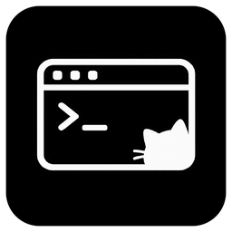
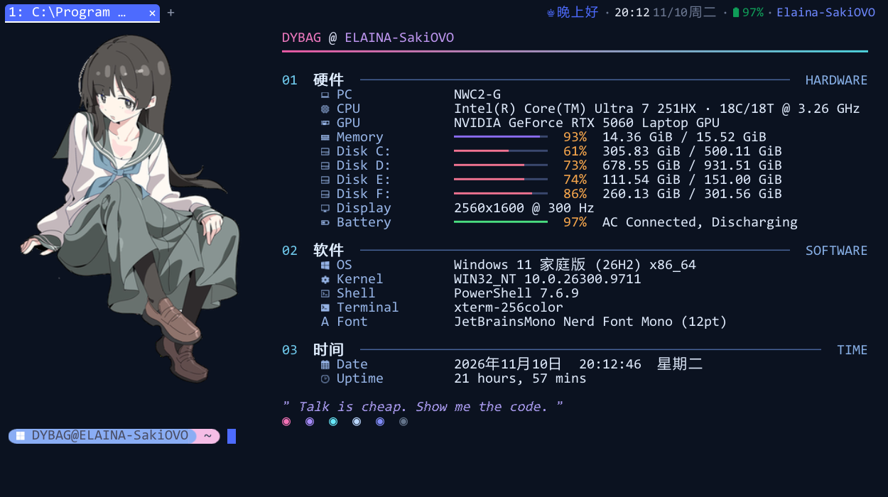
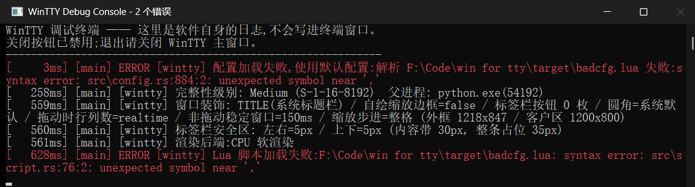

<div align="center">



<h1>VectorTerm</h1>

<p><b>Windows 原生终端模拟器</b><br>
wezterm 的终端核心 · 自研轻量渲染层 · Kitty 风格光标尾迹 · Lua 配置</p>

<p>
  
  
  
  
  
</p>

<p>
  <a href="#快速开始">快速开始</a> ·
  <a href="#特性">特性</a> ·
  <a href="#内置主题">内置主题</a> ·
  <a href="#性能">性能</a> ·
  <a href="#配置示例">配置</a> ·
  <a href="#文档索引">文档</a>
</p>

</div>



> 上图是用内置主题 [`config/deepseek.lua`](config/deepseek.lua) 渲染的**真实窗口帧**,
> 内容是**打开 VectorTerm 后的第一屏**:你自己的 PowerShell 7 profile 跑起来的
> fastfetch(立绘 logo + 硬件 / 软件 / 时间信息)与 oh-my-posh 提示符,加上主题的
> 蓝色活动标签和标签栏右侧状态栏(时段问候语 / 时钟 / 日期 / 电量 / 签名)。
> 没有演示脚本、没有模拟按键,也不是画出来的效果图;窗口尺寸完全沿用主题
> 设定的 1250×750。重新生成只需
> `python tools/diagnostics/readme_shot.py`(先 `build.cmd --release`)。

## 这是什么

一个只面向 Windows 的终端模拟器。终端解析不重复造轮子 —— 直接复用 wezterm 的
`wezterm-term` 状态机;把精力放在 **渲染层** 和 **交互手感** 上:

- **光标:尾迹 + 本体形状 / 尺寸 / 闪烁 / 动画都可自定义**。wezterm 没有尾迹。这里按 Kitty 的算法移植:光标立即定位,尾迹是一个四角各自
  指数追赶的拉伸四边形,输入越密追得越快,松手即收尾。本体还能改长宽、锚点、粗细,
  配闪烁周期 / 占空比 / 灭相表现(消失、淡出、空心描边),以及尺寸脉冲、透明度呼吸两种
  常驻动画。见 [docs/cursor-trail.md](docs/cursor-trail.md) 与 [手册 §10](docs/config-manual.md#10-光标尾迹)。
- **两条渲染路径,一份显示列表**。CPU(softbuffer + GDI `BitBlt`)与 GPU(wgpu/DX12 实例化四边形)
  共用同一份 `Frame`,不会出现"切了后端下划线偏半像素"。默认走 CPU:拖动缩放窗口时不会被
  DXGI 拉伸旧帧;4K / 高刷场景可一行配置切 GPU。
- **配置就是 Lua**。键位、颜色、字体、标签栏、动画参数全部可改,保存即热重载;
  `VectorTerm.exe --config .wezterm.lua` 能直接吃 wezterm 原配置。
- **四套内置配色,直接编进 exe**:DeepSeek 夜空蓝 / ChatGPT 纯灰阶 / Claude 黏土橙 /
  Gemini 蓝紫粉,用 `include_str!` 嵌进 `VectorTerm.exe`,单个 exe 拷到没有 `config\` 目录的
  机器上也能照常套用。见 [内置主题](#内置主题)。

> 定位很明确:**不追求跨平台,先把 Windows 做快做爽。**

## 内置主题

四套都在 [`config/`](config/),结构完全一致(1250×750 窗口、14 号字、行高 1.0、状态栏字号 0.9、
片段间距 0、空格宽度 0.2),只是配色和状态栏脚本不同:

| 文件 | 风格 | 画布 | 强调色 | 活动标签 |
|---|---|---|---|---|
| [`config/deepseek.lua`](config/deepseek.lua) | DeepSeek 夜空蓝 | `#0B1220` | `#4D6BFE` 品牌蓝 | 蓝底白字 |
| [`config/chatgpt.lua`](config/chatgpt.lua) | ChatGPT 纯灰阶 | `#212121` | `#FFFFFF` | 白底黑字 |
| [`config/claude.lua`](config/claude.lua) | Claude 黏土橙 | `#1F1E1D` | `#D97757` | 橙底深墨字 |
| [`config/gemini.lua`](config/gemini.lua) | Gemini 蓝紫粉 | `#131314` | `#1A73E8` / `#8AB4F8` | 蓝底白字 |

ChatGPT 那份是纯灰阶(界面没有任何彩色,只把 ANSI 16 色压到约 12% 饱和度以便
`git diff` / `ls` 还能分色);其余三套各有品牌色的分屏渐变与光标尾迹配色。

**三种用法任选**:

1. 配置里写 `theme = "chatgpt"` 当配色底表,再把自己的字段深合并盖上去。查找顺序是
   **磁盘优先、内嵌兜底** —— 旁边有同名 `.lua` 就用它(方便改色),完全没有才用 exe
   里的那份,详见 [手册 §2.5](docs/config-manual.md#25-内置主题)。
2. 配置管理器里选中某份,右键「设为当前配置」→ 整份复制到
   `%USERPROFILE%\.config\VectorTerm\current\`(该目录只允许一份 `.lua`)。
3. `VectorTerm.exe --config config\deepseek.lua` 临时试色。

`deepseek.lua` 还带一段 `wezterm.on('update-right-status')` 状态栏脚本:
**时段问候语 + 时钟 + 日期 + 电量 + 签名**,画在标签栏右侧(本页头图右上角就是它)。
外观(字号 / 栏高 / 留白 / 片段间距 / 空格宽度)一律在 `status_bar` 表里单独调,
配置管理器「状态栏」分组拖滑杆即可,见
[手册 §8.7](docs/config-manual.md#87-状态栏左边一条右边一条)。

## 特性

### 终端核心

- ConPTY 会话,默认 PowerShell 7 → Windows PowerShell → cmd 自动降级(可用 Lua 指定)
- `wezterm-term` 全量解析:ANSI/VT/OSC、256 色 + 真彩色、回看(rewrap)、备用屏、括号粘贴
- 键盘编码交给状态机:DECCKM、LNM、modifyOtherKeys / CSI-u、F1–F24、Alt/Ctrl 组合、IME 提交
- 鼠标报点 X10 / UTF-8 / SGR × 1000 / 1002 / 1003,外加 `1004` 焦点上报
- OSC 52 剪贴板、OSC 8 超链接、iTerm2 / Kitty 图片协议(每格一块落格,GPU 每图一条纹理)

### 渲染

- 粗体 / 斜体 / 暗淡 / 反显 / 闪烁 / 四种下划线 / 删除线,粗体与斜体优先用字体的真 face
- 按字形角色排版:powerline 铺满整格、制表符保线宽、PUA 图标等比缩进,不越界不压邻格
- 半块与象限块(`▄▀█▌▐▖▗`)按格子几何直接填矩形,**上下行之间没有横缝**
- 中英混排按 em 归一,汉字之间不留"空格缝";Nerd Font 图标自动发现并排在文本回退之前
- 自定义背景:壁纸 / 模糊 / 渐变 / 五种填充 / 整窗半透明(配置项名对齐 wezterm)

### 交互

- 鼠标框选:双击选词、三击选行,松开即复制;应用抓了鼠标时按住 `Shift` 仍可本地选择
- 分屏焦点:鼠标点窗格即聚焦、`Ctrl+Shift+方向键` 切相邻、`Alt+1..9` 直达;只有聚焦窗格显示输入光标。切换时新窗格的光标**立刻**出现在真实位置,「从那边过来」的观感全交给一条跨窗格尾迹 —— 它和被拉长的 kitty 光标尾迹是**同一个 `CursorTrail` 实例**(同一个积分器、同一份停留门限 / 硬上限 / 淡入曲线 / 颜色),只是起点被搬到旧窗格的光标上,所以手感逐帧一致(`pane_focus.sync_trail`,配置管理器里有一键同步按钮)
- 多标签 + 标签栏:圆角标签、`×` 关闭、`+` 新建,`Ctrl+Shift+T/W`、`Ctrl+Tab`、`Ctrl+1..9`
- 分屏(wezterm 同款快捷键):分割线精确居中,**粗细、文字到线的距离(默认只留 1px,配置管理器里有 0~24px 滑杆)、两端留白、单色 / 多色渐变**都能调,配置管理器里有实时预览,见 [手册 §15.8](docs/config-manual.md#158-分割线外观)
- 窗格大小调整:**鼠标直接拖分割线**改两侧占比,`Ctrl+Shift+Alt+方向键` 每次移动一步;热区宽度、最小占比、步长都可配,见 [手册 §15.8.7](docs/config-manual.md#1587-拖动分割栏与快捷键调整窗格大小)
- 命令面板:`Ctrl+Shift+P`(或 `Ctrl+Shift+F` 后输入 `/`),`files` 把当前窗格变成文件管理器(铺满宿主 pane,分屏时只盖这一边)、`settings` 开可视化配置管理器、`help` 列命令、`key` 查键位(长表可 `↑↓` / `PgUp` / `PgDn` 翻页)、`reload` 重载配置、**原来的 `files-gui` 等 shell 内命令已全部移除**,见 [手册 §11.6](docs/config-manual.md#116-命令面板替代-shell-内命令)
- 自定义键位可拆成独立 Lua 文件,配置里用 `keys_file = "vim.lua"`(或复数 `keys_files`)引用;外部文件是**基础层**、配置内联 `keys` 是**覆盖层**,两层都没写出来的组合键一律**退回终端内置默认键位**——只改想改的键即可。配置管理器顶部「键位方案」下拉一键切换、「新建键位文件」按钮一键生成并引用、「键位映射」分组增删自定义键位,见 [手册 §15.11](docs/config-manual.md#1511-键位方案文件keys_file)
- 窗口尺寸与字号**解耦**:`window_width` / `window_height` 写**物理像素**即按像素开窗(125% 缩放下写 1300 就是 1300 像素宽),之后调 `font.size` 窗口纹丝不动(用 `initial_cols/rows` 按格数反推时,改字号会连带改窗口大小);启动日志会打印「初始窗口尺寸来源」,见 [手册 §7.2](docs/config-manual.md#72-初始窗口尺寸)
- 去掉 Windows 顶部标题栏:`window_decorations = "INTEGRATED_BUTTONS|RESIZE"` 把最小化/最大化/关闭画进标签栏,或 `"RESIZE"` 只留自绘缩放热区;简写 `window_titlebar = false` 效果相同,见 [手册 §7.4](docs/config-manual.md#74-简写-window_titlebar)
- 标签栏右侧可挂**自定义状态栏**:内置 DeepSeek 主题已带上「时段问候语 + 时钟 + 日期 + 电量 + 签名」,颜色跟随主题;用 `wezterm.on('update-right-status')` + `wezterm.format()` + `wezterm.battery_info()` + `wezterm.nerdfonts` 写,见 [手册 §8.7](docs/config-manual.md#87-状态栏左边一条右边一条)
- 状态栏文字还是由脚本(`update-right-status`)决定,但**外观可以在配置里单独调**:`status_bar` 一组键管字号(`font_scale`)、整条栏高度(`height`)、左右留白(`padding`)、片段间距(`item_spacing`)和空格宽度(`space_width`,脚本里小点两侧的空隙就是空格,调小即可收紧切片),配置管理器「状态栏」分组拖滑杆即可,见 [手册 §8.7](docs/config-manual.md#87-状态栏左边一条右边一条)
- 文件浏览器:命令面板 `/files` 打开**铺满当前窗格**的列表(路径就是 shell 的 cwd),`Ctrl+Shift+E` 从左边分出**侧边栏**;面板**属于某个 pane** —— 在哪个终端打开就只铺那个 pane,点到另一个终端会连列表带 cwd 一起移交;**目录双向同步** —— 终端里 `cd` 面板跟着走,面板里进目录会给终端写一行 `cd`(开关 `files_gui.follow_cwd` / `push_cwd`,默认都开;PowerShell 靠自动注入的 prompt 钩子上报 OSC 7,cmd 靠读进程工作目录);方向键 / 鼠标选目录,回车默认**另开一个窗口**用 `nvim` / `vim`(可自定义)打开文件,也能改成右侧分屏或当前终端的 shell(见 `files_gui.open_mode`);编辑器找不到时面板底部给英文提示,见 [手册 §15.10](docs/config-manual.md#1510-文件浏览器)
- 关窗确认:有程序在跑时先在内容区正中问一句 `[Y]es / [N]o`
- 资源管理器右键集成:在**文件夹空白处**、**文件夹图标上**、**盘符上**右键都有「在此处打开 VectorTerm」,窗口直接落在那个目录(命令行 `--cwd` 传路径,`-d` 是等价别名);安装包里的附加任务默认勾选,想单独给某个 exe 注册/撤销用 `context-menu.ps1`。Windows 11 的老式菜单项会收在「显示更多选项」里,`Shift + 右键` 可直达,见 [构建文档](docs/build.md#右键菜单那一项)
- 滚轮回看是亚行缓动动画,不是整数行瞬移;按键时输入优先回底,长按回车不会卡在半路
- 回看缓冲可视化:每个 pane 一条**可拖动滚动条**(显示策略 always/auto/never、停靠侧、轨道显隐、轨道/滑块/悬停三色、宽度与透明度都可配),拖选到窗口边缘会**自动滚屏并继续扩选**;`Ctrl+Shift+F` 在**全部历史**里搜索、高亮匹配并逐条跳转,见 [手册 §11.4–11.5](docs/config-manual.md#114-可视化滚动条与边缘滚屏)
- 浮层是有动画的:搜索栏 / 命令面板打开时**从下方非线性升到位 + 94%→100% 放大 + 淡入**(190ms,位移与缩放共一条 ease-out 曲线),关闭 160ms 收干净;打开的一瞬间**输入光标从终端里飞过去**,和跨窗格切换共用同一个 `CursorTrail`(同一份停留门限 / 衰减 / 颜色),见 [手册 §11.5](docs/config-manual.md#115-历史搜索)
- 文件面板也是滑出来的:侧边栏(`Ctrl+Shift+E`)和命令面板 `/files` 打开时**整块从左边滑到右边**(190ms 缓出),收起 160ms 滑回去;宽度不变、文字不重排,右边那条竖线跟着一起走;滑动期间绘制被裁在自己的矩形里,分屏时不会糊到邻窗格的终端上,见 [手册 §15.10](docs/config-manual.md#1510-文件浏览器)
- 浮层是**真模态**:开着时光标从终端收起、输入法上屏的中文进输入框(拼音组合串也画在框里),不会漏成 shell 的一条命令;中文输入法把字母键的虚拟键码改写成 `VK_PROCESSKEY` 导致 `Ctrl+Shift+E` / `Ctrl+C` 这类快捷键失配的老问题,在窗口过程里统一还原,见 [键位总览](docs/keyboard-shortcuts.md#中文输入法开着的时候)

### 会话保持(wezterm 式多路复用)

借鉴 wezterm 的 mux 架构:所有 shell 由一个后台守护进程(`vectorterm --mux-server`)
托管,GUI 窗口只是它的客户端。关掉窗口或标签后,**会话继续运行、输出不丢**,
下次启动一键恢复现场(滚动缓冲完整回放)。

```lua
-- config.lua 里开启
session_persistence = true
```

- **detach 即关闭**:会话保持开启后,关标签 / 关窗口都只是「断开视图」,shell
  和它正在跑的程序(编译、下载、vim 会话…)继续活着
- **attach 即恢复**:下次启动自动 reattach 最近的会话;`Ctrl+Shift+A` 切换回
  守护进程里其他未显示的会话
- **守护进程**常驻后台,与 GUI 解耦;`vectorterm --mux-server` 手动起,`vectorterm --mux-list`
  列出存活会话,`vectorterm --mux-attach <id>` 恢复指定会话
- 与 wezterm 的差异:VectorTerm 只做本机单用户(命名管道,无 TLS/SSH),server 端
  存原始输出字节、前端 replay 重建屏幕 —— 语义等价,实现更轻

### 配置与窗口

- Lua 配置 + 热重载(保存约 0.4s 生效)+ `VectorTerm.*` 运行时 API(改色、发文本、重载 …)
- wezterm 配置兼容层:`require 'wezterm'`、`config_builder()`、`font_with_fallback`、`action.*`
- 窗口装饰完全对齐 wezterm:`TITLE` / `RESIZE` / `NONE` / `INTEGRATED_BUTTONS` 任意组合
- 发行版是 GUI 子系统:双击不弹控制台;配置写错时弹出**独立调试终端**,当前 shell 窗口零注入

## 快速开始

> 不想自己编译:直接下 [Releases](https://github.com/yunshangnanchen/VectorTerm/releases)
> 里的 `VectorTerm-<版本>-setup.exe`(中文安装向导,默认装到当前用户、不需要管理员)。
> 版本要自己发的话,推一个 `v*` tag 就行,见 [构建文档](docs/build.md#自动发布github-actions)。

**环境要求**:Windows 10 1809+(ConPTY)、Rust stable(MSVC 工具链)、
Visual Studio 2019/2022/2026 Build Tools(含 C++ 工具集与 Windows SDK)、git。

```bat
:: 首次构建会浅克隆 wezterm-term 源码(需要网络),之后是增量构建
git clone https://github.com/yunshangnanchen/VectorTerm.git && cd VectorTerm

build.cmd --release                  :: 产出 target\release\VectorTerm.exe(GUI 子系统,无控制台窗口)
target\release\VectorTerm.exe            :: 直接运行
target\release\VectorTerm.exe --config C:/path/to/config.lua
target\release\VectorTerm.exe --cwd "D:\work"   :: 指定初始目录(资源管理器右键菜单走的就是这条)

:: 资源管理器右键「在此处打开 VectorTerm」(免安装;加 -Remove 撤销)
powershell -ExecutionPolicy Bypass -File .\context-menu.ps1

build.cmd test --release             :: 单元测试
build.cmd run -- --config config\config.lua

build.cmd installer                  :: 打成安装包 target\installer\VectorTerm-<版本>-setup.exe

:: 配置管理器(独立的 Rust + egui 图形化配置工具)
target\release\vectorterm-settings.exe   :: 三栏界面。左栏分两栏:「配置文件」(程序目录 / 用户目录的 lua)
                                     与「键位文件」(keys.lua / keys1.lua …,放在 ~/.config/VectorTerm/keys/);
                                     右键任意配置文件「设为当前配置」→ 复制进 ~/.config/VectorTerm/current/,
                                     终端只加载那一份(目录里多份会报错并退回程序默认);
                                     中栏显示当前文件的配置项 / 键位映射;
                                     顶部「键位方案」下拉切换 keys_file,新建键位文件按 keys → keys1 自动命名
```

> 首次构建请用 `build.cmd` 而不是裸 `cargo build`:它会自动跑 `setup.ps1`、用 `vswhere`
> 初始化 MSVC 环境(vcvars),并设置 `CRATE_CC_NO_DEFAULTS=1`。原因见
> [docs/build.md](docs/build.md#为什么不能直接-cargo-build)。

> 配置文件按 `--config` → `%USERPROFILE%\.config\VectorTerm\current\` 里唯一的 lua → `<exe>\config\config.lua`
> → … 的顺序查找,先命中的生效。改配置请在配置管理器里「设为当前配置」(复制到
> `~/.config/VectorTerm/current/`),别改软件目录里的默认文件。

> **从 WinTTY 升级**:程序已更名,可执行文件是 `VectorTerm.exe`(配置管理器
> `vectorterm-settings.exe`),PATH / 快捷方式里的旧命令名不再存在,重装安装包即可更新。
> 已有的配置会自动迁移:`%USERPROFILE%\.config\wintty\` 在首次启动时整块搬到
> `%USERPROFILE%\.config\VectorTerm\`(搬不动就继续用旧目录),旧 Lua 脚本里的
> `wintty.set(...)` / `wintty.notify(...)` 也仍然有效。

## 性能

release 构建 / 200×60 格 / 画布 1816×976 / 满屏彩色文本:

| 阶段 | CPU 软渲染 | GPU(DX12) |
|---|---:|---:|
| 快照 + 布局 | 1.51 ms | 1.33 ms |
| 光栅化 / GPU 编码 | 12.23 ms | 0.95 ms |
| **单帧 CPU 侧合计** | **13.74 ms** | **2.28 ms** |

真实窗口 1920×1080 满屏:GPU 帧间隔稳定 3.33 ms(受 DXGI 提交节流,60 Hz 屏上用户看到的是 60 FPS);
CPU 14.5 ms、p95 19 ms,会偶发掉帧。冷启动首帧 GPU 580 ms / 峰值 485 MB,CPU 112 ms / 55 MB。

**吞吐不在终端软件这一层。** 同一台机器、同一段输出,五方端到端实测(Kitty / Ghostty /
WezTerm / Windows Terminal / VectorTerm)全部落在 **1.37–1.85 MiB/s**;只读的 ConPTY 管道
(不渲染)也只有 0.94 MiB/s,而生成端直接写 NUL 能跑到 40 MiB/s —— 天花板是 ConPTY / conhost,
不是渲染器。完整口径、原始 CSV 与一键复现脚本见 [benchmark/README.md](benchmark/README.md)。

## 配置示例

只换配色的话一行就够 —— 其余全部用内置默认值,主题会从 exe 内嵌副本里读:

```lua
return { theme = "deepseek" }
```

要改更多项,就在返回表里逐项写(未写的字段由默认值 / 主题底表补齐):

```lua
return {
  shell = "pwsh.exe",                    -- 默认就是 PS7;没装会自动降级 powershell → cmd
  render = "cpu",                        -- cpu(默认,拖动不抖)| gpu(更快)| auto
  font = { family = "MesloLGL Nerd Font Mono", size = 18, fallback = { "Microsoft YaHei" } },
  colors = { background = "#0c0c0c", foreground = "#cccccc", cursor_bg = "#ffffff" },
  cursor = {
    trail = 20,                          -- 静止多少毫秒后尾迹开始跟随;0 = 关闭
    trail_decay  = "0.1 0.4",            -- (最快, 最慢)衰减时间(秒)
    trail_max    = 220,                  -- 单段动画硬上限(ms)
  },
  tab_bar = { max_width = 16, show_close_button = true },
  keys = {
    ["ctrl+shift+r"] = "reload",
    ["f12"]          = "send:dir\r",
    ["ctrl+alt+t"]   = function() VectorTerm.notify("hi") end,
  },
}
```

全部配置项(标签栏、窗口装饰、选区、字体回退、`VectorTerm.*` API …)见逐项手册
**[docs/config-manual.md](docs/config-manual.md)**(从安装到全量配置,每项的类型 / 默认值 /
取值范围 / 生效时机)、[docs/configuration.md](docs/configuration.md) 与注释版
[config.example.lua](config.example.lua)。

**配置写错了会怎样**:和 wezterm 一样,软件自身的错误不进当前终端 —— 主窗口照常用默认配置起
shell,旁边弹出一个独立的 `VectorTerm Debug Console` 列全部日志,ERROR 行标红:



## 架构

```text
┌──────────────────────────── VectorTerm.exe ────────────────────────────┐
│  main.rs(winit 事件循环)                                           │
│   ├── GuiState:窗口 + 终端句柄 + 渲染器 + 动画状态                    │
│   ├── SharedWriter:键盘输入 + 终端应答 → 统一流入 PTY(低延迟刷写线程) │
│   └── UserEvent{Repaint, TitleChanged, ChildExited}                 │
│                                                                    │
│   [主线程]  winit 事件 + 渲染(GPU surface 或 softbuffer surface)     │
│   [parser]  阻塞读 PTY 输出 → Terminal::advance_bytes → Repaint      │
│   [flusher] SharedWriter 缓冲 → write_all 到 PTY 输入                │
│   [waiter]  子进程 wait() → ChildExited                             │
│                                                                    │
│   PTY 输出 ──► wezterm-term(grid / 滚动区 / 调色板)                  │
│                    │ snapshot(锁内快速拷贝,可带回看偏移)             │
│                    ▼                                               │
│   render.rs:布局 → 显示列表(frame.rs)                               │
│        ├─ paint_cpu:逐像素混合 → softbuffer → present               │
│        └─ gpu.rs:字形图集 + 实例化四边形 → wgpu(DX12) → present      │
│   cursor.rs:尾迹动画状态机(插值 + 缓动)                             │
└────────────────────────────────────────────────────────────────────┘
```

```text
VectorTerm/
├── src/                 实现(render / frame / gpu / cursor / scroll / tabbar / font …)
├── settings-gui/        配置管理器(独立 Rust + egui crate,与终端本体零耦合)
├── config/              config.lua 默认配置 + 四套内置主题(deepseek / chatgpt / claude / gemini)
├── config.example.lua   全部可选项(注释版)
├── VectorTermLogo.png       图标母版(1080×1080,tools/gen_icons.py 的输入)
├── assets/icons/        由母版生成的分辨率梯子 + VectorTerm.ico(exe 图标)
├── assets/              截图(screenshot.png:deepseek.lua 主题下的真实启动首屏)
├── docs/                设计文档与原理剖析
├── benchmark/           性能报告 + 原始 CSV + 一键复现脚本
├── tools/               辅助脚本(gen_icons.py:图标分辨率梯子 / gen_nerdfonts.py)
├── tools/diagnostics/   可复现的诊断与截图脚本(已入库;主题实机回归、图片光标定位、
│                        README 头图、文档链接审计等),见 docs/build.md 的验证章节
├── patches/             上游补丁(wezterm-term 回绕越界修复)
├── installer/VectorTerm.iss Inno Setup 安装包脚本(PATH 可选、App Paths、卸载清理)
├── build.cmd            唯一构建入口(环境准备 + cargo 透传 + 配置同步 + 打包)
├── setup.ps1 / setup.sh 拉取 wezterm-term 源码并幂等打补丁
├── .wezterm-src/        上游浅克隆(不提交,23 MB,编译必需)
└── target/              构建缓存(不提交;跑 cargo test 后能长到 19 GB)
```

工作区看起来有 19 GB,但**项目本身只有 5.0 MiB**(204 个文件):其余全是 `target/` 里的
Rust 构建缓存 —— debug 版 606 个 `.rlib`(单个 `libnaga` 就 104 MB)、184 份增量编译缓存、
探针 example 的 401 MB `.pdb`。2026-11-10 清过一次,工作区从 19 GB 降到 1.5 GB
(只剩 `release/` 与安装包),`cargo test` 会把 debug 那部分重新长回来。
逐目录的"是什么 / 多大 / 能不能删"见 [docs/layout.md](docs/layout.md),
各模块职责同在此文,依赖选型见 [docs/dependencies.md](docs/dependencies.md)。

## 已知限制(v0.1)

- **GPU 后端拖动缩放窗口时内容会被 DXGI 拉伸一下再弹回**(`wgpu-hal` 把 `DXGI_SCALING_STRETCH`
  写死);默认已改用 CPU 规避,根治方案见 [docs/resize-fix-plan.md](docs/resize-fix-plan.md)
- CPU 后端在 1080p 满屏滚动时一帧约 14.5 ms,会吃满预算
- GPU 后端冷启动首帧约 580 ms、峰值内存约 485 MB,尚未收敛
- 无 HarfBuzz 整形:不支持连字与复杂脚本(单个码点的 Nerd Font 图标不受影响)
- 未实现 kitty keyboard protocol、sixel;历史搜索只覆盖活动 pane(备用屏无回看历史),匹配数有 `search.max_matches` 上限
- 分屏已支持(`Ctrl+Shift+Alt+"` / `%`,另有 `Ctrl+Shift+"` / `%`、`Ctrl+Shift+Alt+V` / `H` 别名),聚焦可用鼠标点击、`Ctrl+Shift+方向键` 或 `Alt+1..9`;窗格大小调整的组合仍是内置硬编码,`keys` 表能拦截但不能把 `AdjustPaneSize` 映射到别的键

完整清单见 [docs/limitations.md](docs/limitations.md)。

## Roadmap

1. **v0.2** — 超链接悬停与点击、矩形块选、正则/增量搜索、kitty keyboard protocol、HarfBuzz 整形
2. **v0.3** — GPU 纵深:静态层缓存、多字形图集分页、HDR / 广色域
3. **v0.4** — pane 尺寸调整、更多光标动画(残影、宽度过渡)
4. **远期** — 跨平台只保证功能等价,性能优化仍以 Windows 为第一优先

## 文档索引

| 文档 | 内容 |
|---|---|
| **[docs/config-manual.md](docs/config-manual.md)** | **Lua 配置完全手册**:逐项类型 / 默认值 / 取值范围 / 生效时机,附 [§19 全量模板](docs/config-manual.md#19-全量配置模板) 与 [§22 默认值总表](docs/config-manual.md#22-默认值总表);可直接复制的示例见 [config.example.lua](config.example.lua) |
| [docs/configuration.md](docs/configuration.md) | 配置解析的设计取舍与原理、wezterm 兼容层、窗口装饰 / 拖动缩放、选区、字体、`VectorTerm.*` API |
| [docs/build.md](docs/build.md) | 构建入口、环境变量、调试终端、换机器跑不起来的排查 |
| [docs/keyboard-shortcuts.md](docs/keyboard-shortcuts.md) | **全部键位与鼠标操作速查**:命令面板 / 分屏 / 标签 / 剪贴板 / 回看 / 文件浏览器 |
| [docs/cursor-trail.md](docs/cursor-trail.md) | 尾迹动画算法:重定向不排队、积压加速、长度钳制;光标本体的自定义见手册 §10.5 |
| [docs/rendering.md](docs/rendering.md) | 渲染后端机制、字形角色排版、图片协议 |
| [docs/rendering-backends.md](docs/rendering-backends.md) · [docs/resize-fix-plan.md](docs/resize-fix-plan.md) · [docs/resize-render-rca.md](docs/resize-render-rca.md) | CPU/GPU 路径细节与拖动缩放抖动的完整排查 |
| [docs/custom-background.md](docs/custom-background.md) | 壁纸 / 模糊 / 渐变 / 半透明的实现与边界 |
| [docs/layout.md](docs/layout.md) | **目录地图**:每个目录是什么、19 GB 的 `target/` 由哪些东西构成、想瘦身按什么顺序删;附 31 个 `src` 模块职责表 |
| [docs/dependencies.md](docs/dependencies.md) · [docs/limitations.md](docs/limitations.md) | 依赖选型、已知限制 |
| [docs/kitty-image-cursor-rca.md](docs/kitty-image-cursor-rca.md) | kitty 图片与 fastfetch 首行输入错位的完整定位(PTY 字节 / 上游源码 / 对照实验) |
| [benchmark/](benchmark/README.md) | 性能报告、五方对比、复现脚本 |

## 致谢

- [wezterm](https://github.com/wezterm/wezterm) —— 终端状态机 `wezterm-term` 与 `termwiz`,以及窗口装饰的语义参考
- [kitty](https://github.com/kovidgoyal/kitty) —— 光标尾迹算法与图形协议
- [ghostty](https://github.com/ghostty-org/ghostty) —— 适配器选择与"失败要明说"的处理方式

## 许可

**PolyForm Noncommercial 1.0.0** —— 非商业用途随意使用,商业用途不获授权。

| | |
|---|---|
| 可以用 | 个人使用、学习研究、业余项目、教学、慈善、公共科研、公共安全与卫生、环保、政府机构;可以修改,可以再分发(含修改后的版本),免版税 |
| 不可以 | 用于营利,随商品或服务收费,作为收费产品或收费服务的一部分提供 |
| 前提 | 分发时附上许可条款(或它的网址)和 `Required Notice` 行;不提供任何担保 |

完整条款见 [LICENSE](LICENSE)(英文,具法律效力);
[LICENSE.zh-CN.txt](LICENSE.zh-CN.txt) 是方便阅读的中文参考译本。

> 这不是 OSI 认可的开源许可 —— 源码公开可读、可改,但商业化需另行授权。

第三方依赖遵循各自许可(wezterm 为 MIT;那部分代码的许可不因本项目而改变),
汇总见 [THIRD-PARTY-NOTICES.md](THIRD-PARTY-NOTICES.md) —— 分发二进制时请一并附上。

> 本项目目前是 v0.1:构建通过、冒烟测试通过、`cargo test --release` 全绿。
> 接口和配置项仍可能变动。
